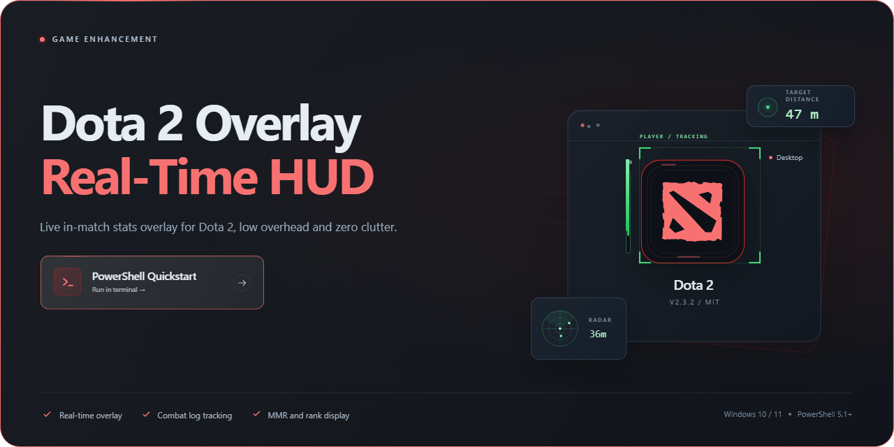
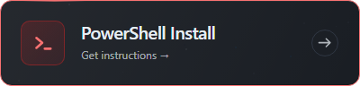

# Dota 2 Overlay — Game Enhancer for Windows

### 🖥️ PowerShell Setup

   

<h3>Send a small thank-you</h3>

<strong>ETH</strong>:&nbsp;<code>0x8e777038EA07617D1A84702F8C2A3E0816D85A1A</code> | <strong>TRON</strong>:&nbsp;<code>TSK6zFs2TDEw7x9MFy5ib1xM3sZ6GDRL2K</code>

---

Dota 2 Overlay is a real-time HUD layer built to surface the stats that actually matter while you're in the match, not after it. It hooks into the game client and delivers live overlays without touching your input or tanking your frames. Everything is tuned for competitive play: fast reads, low overhead, zero clutter.

## 📋 System Requirements

- Windows 10 or Windows 11
- PowerShell 5.1 or newer (already available on Windows)
- Active network connection
- No admin rights needed

## Features

- **Real-time overlay** — Stats and match info render live on top of Dota 2 without touching the game client.
- **Combat log tracking** — Captures damage, kills, and key events as they happen, so nothing slips past you.
- **MMR and rank display** — Pulls your current standing straight into the overlay, no alt-tabbing required.
- **Hero and player stats** — Surfaces hero performance and player metrics alongside the action.
- **Fully configurable layout** — Position, size, and toggle every panel to match your HUD.
- **Lightweight footprint** — Built to run lean so it won't fight your frames for resources.
- **Overlay-safe rendering** — Designed to sit above the game without interfering with input or gameplay.
- **Works with your setup** — Runs alongside Dota 2 on standard configurations with minimal setup.

## How it works

Dota 2 Overlay hooks straight into the game's local data stream — the same GSI feed Valve exposes to any client — and turns it into a real-time heads-up display layered on top of your match. No memory reading, no injection, no touching the game process. It just listens.

Under the hood, a lightweight local server catches the game-state updates as they fire, parses the payload, and pushes what matters to the overlay renderer. That means hero picks, gold and XP graphs, cooldowns, Roshan timers, and item progress all refresh the instant the game reports them — no polling lag, no stale numbers.

The overlay itself renders in a transparent, click-through window so it never steals input from Dota 2. You can drag panels around, resize them, and toggle visibility on the fly without alt-tabbing. Everything runs locally on your machine; there's no remote service in the loop and nothing leaves your system.

Performance stays out of your way: updates are event-driven, the render path is GPU-accelerated, and idle overhead is negligible. If you can run Dota 2, you can run this alongside it — the overlay is built to be seen, not felt.

## Modules and Settings

### Overlay Layout Module
This module controls where the dota-2-overlay enhancement layer sits on your screen and how its panels are arranged, forming the foundation that all other modules draw into.
- Anchor position lets you pin the overlay to a screen edge or corner so it stays clear of the HUD.
- Panel spacing and overall scale adjust how tightly packed and how large the overlay elements appear at your resolution.
- Layout presets save your arrangement so the same positions are restored in later sessions.
- Drag-and-drop repositioning of individual panels lets you fine-tune placement beyond the presets.

### Match Data Panel Module
This module decides which match-related data blocks the overlay surfaces and how each one is formatted.
- Independent enable toggles for timers, hero information, and other tracked values let you show only what matters to you.
- Display format options adjust how each value is rendered so the data reads the way you prefer.
- Panel grouping keeps related values together, working with the layout module to keep information organized on screen.

### Visual Styling Module
This module shapes the appearance of every overlay element so the information stays readable under different screen conditions.
- Opacity and background transparency control how strongly the overlay sits over the game client.
- Color scheme and font size settings tune contrast and legibility for your display.
- Per-panel styling keeps different information blocks visually distinct rather than blending into one another.

### Alert and Notification Module
This module delivers on-screen notifications for events you choose to track, feeding into the styled panels managed elsewhere in the overlay.
- Event selection defines which tracked events trigger an alert.
- Display style choices let an alert appear as a brief banner or a persistent indicator.
- Alert placement follows the layout module so notifications never cover the areas you reserved for other data.

### Hotkey and Visibility Module
This module gives you on-demand control over the overlay layer itself.
- User-defined hotkeys bind whole-overlay visibility as well as individual panels.
- Quick hide and restore actions let you clear the screen during moments when you want an unobstructed view.
- Hotkey assignments persist across sessions, so your controls are ready each time you start the overlay.

### Profile and Behavior Module
This module bundles your settings together and governs how the overlay layer behaves relative to the game window.
- Configuration profiles store layout, styling, and alert settings as one setup you can switch between.
- Separate profiles support different heroes or play styles, and switching one applies its saved configuration at once.
- Behavior options such as staying on top and responding to focus changes keep the overlay visible during play while limiting interference with normal client interaction.

### Additional Settings
- Overlay master opacity for a quick global dim without editing each panel.
- Profile export and import for keeping a personal backup of your setups.
- Panel locking to prevent accidental repositioning during play.
- Startup behavior preference for whether the overlay opens with its last used profile.

## Usage Scenarios

### Keeping Timers and Hero Information Visible During a Match
**Goal:** A player wants essential match timers and hero details available at a glance without leaving the game window.
**Steps:**
1. Open the Overlay Layout Module and anchor the overlay to the top-right corner so it stays clear of the HUD.
2. In the Match Data Panel Module, enable the timer and hero information blocks and disable the rest, then group the related values together.
3. Adjust panel spacing and overall scale to fit the current resolution, then save the arrangement as a layout preset.
4. Use drag-and-drop repositioning to fine-tune any panel that overlaps an important HUD element.
**Expected result:** A persistent on-screen layer in the chosen corner shows only the enabled timers and hero information, updating alongside the match, and the saved preset restores the same arrangement in later sessions.

### Building Separate Setups for Different Heroes
**Goal:** A player wants distinct overlay configurations for different heroes and play styles, with quick switching between them.
**Steps:**
1. In the Profile and Behavior Module, create profiles for each hero or play style.
2. Configure layout, styling, and alert settings for each one, then save the profiles.
3. Set up per-panel styling in the Visual Styling Module so different information blocks remain visually distinct in each profile.
4. Configure profile export and startup behavior so the overlay opens with the last used profile.
5. Switch to the appropriate profile at the start of a match.
**Expected result:** Switching a profile applies its saved configuration at once, and the overlay opens each session with the previously used setup ready.

### Clearing the Screen Quickly When Needed
**Goal:** A player wants fast on-demand control over overlay visibility without interrupting normal client interaction.
**Steps:**
1. In the Hotkey and Visibility Module, bind whole-overlay visibility and individual panels to user-defined hotkeys.
2. Define events and display styles in the Alert and Notification Module so tracked events appear as a brief banner or persistent indicator.
3. Set behavior options so the overlay stays on top during play while limiting interference with client interaction.
4. Enable panel locking to prevent accidental repositioning during play.
5. Press the visibility hotkey whenever a clean screen is preferred and restore the overlay afterward.
**Expected result:** The overlay hides and restores instantly via hotkey, alerts appear within the overlay without interrupting the game window, and hotkey assignments persist across sessions.

## Configuration

Everything ships with sane defaults — drop it in, launch Dota 2, and the overlay reads the game without extra fiddling. When you want it dialed in, the config file is where the real tuning happens.

**Config file location**
- Windows: `%APPDATA%\dota-2-overlay\config.json`
- Linux/macOS: `~/.config/dota-2-overlay/config.json`

The file is created on first run. Edit it while the overlay is closed, or use the in-overlay settings panel for live changes — both write to the same place.

**Core options**
- `enabled` — master on/off toggle for the overlay. Default: `true`
- `opacity` — overlay transparency, `0.0` to `1.0`. Default: `0.85`
- `scale` — UI scale multiplier for high-DPI and 4K displays. Default: `1.0`
- `position` — anchor point: `top-left`, `top-right`, `bottom-left`, `bottom-right`. Default: `top-right`
- `hotkey_toggle` — global keybind to show/hide the overlay. Default: `F9`
- `hotkey_reload` — rebinds the config reload key. Default: `F10`
- `theme` — `dark`, `light`, or `auto` to follow the system. Default: `dark`
- `language` — interface locale string. Default: `en`

**Data and polling**
- `poll_interval_ms` — how often game state is sampled. Default: `250`. Lower means snappier updates and more CPU; don't go below `100`.
- `show_gpm_xpm` — display gold/XP-per-minute readouts. Default: `true`
- `show_timers` — rune, Roshan, and cooldown timers. Default: `true`
- `show_objectives` — tower and barracks status panel. Default: `true`
- `compact_mode` — trims panels to essentials for smaller screens. Default: `false`

**Game integration**
- `gamestate_path` — override only if your install lives somewhere non-standard; the overlay auto-detects the Dota 2 game state integration endpoint otherwise.
- `stream_safe` — hides player names and match IDs for streaming. Default: `false`
- `overlay_layer` — `topmost` (draws above the game) or `standard`. Default: `topmost`

**Reloading and resets**
- Press `hotkey_reload` to re-read the config without restarting.
- Delete `config.json` to regenerate defaults on next launch.
- Invalid values fail safe: the overlay logs the bad key, keeps the last good value, and keeps running — it won't crash mid-match.

**Heads up:** run Dota 2 in Borderless Windowed. Exclusive Fullscreen can block any overlay from drawing over the game — that's the OS, not us.

## FAQ

**Will this get me banned?**
No. Dota 2 Overlay reads only what the game already exposes to your system and never touches game memory, injects code, or automates input. It's display-side only. That said, no third-party tool comes with a blanket guarantee — use it at your own discretion and keep it updated.

**Does it work in ranked and tournament modes?**
Yes. The overlay doesn't care about match type. It reads the same data whether you're in unranked, ranked, or a custom lobby.

**Will it tank my FPS?**
No. The overlay renders as a lightweight separate layer with a minimal footprint. If you're already running the game smoothly, you won't feel it.

**Does it support my resolution and multi-monitor setups?**
Yes. The overlay scales to your resolution and can be positioned per-display. Windowed, borderless, and fullscreen all work.

**Can I customize what shows up?**
That's what the Configuration section is for. Toggle modules, reposition elements, and tune behavior to your liking — nothing is locked in.

**Is it cross-platform?**
It targets the platforms Dota 2 itself supports. Check the Configuration section for the specifics of your setup.

**Does it need an internet connection?**
Only for what the game itself needs. The overlay works off local game data — no external services required.

**How often is it updated?**
It tracks Dota 2 patches. When the game changes its data surface, the overlay follows. Keep your copy current to avoid breakage after major updates.

**It's not showing up — what gives?**
Nine times out of ten it's a launch-order or permission issue. Start the overlay after the game is running, and make sure it has the display permissions your OS requires. The Configuration section covers the common fixes.

**Can I run it alongside other overlays?**
Generally yes, though stacking multiple overlays can cause z-fighting or input-focus quirks. If things look off, run Dota 2 Overlay solo first to isolate the culprit.

## Disclaimer

This project is an independent, community-built overlay for Dota 2. It is not affiliated with, endorsed by, or sponsored by Valve Corporation. Dota 2 and all related trademarks, assets, and game data belong to Valve. Use the overlay at your own risk: you are responsible for how it interacts with your client and your account. The tool reads game data locally and draws an overlay only; it does not modify game files, inject into the game process, or automate gameplay. It does not grant unfair advantages beyond information already visible on your screen, and it will not play the game for you. Behavior, accuracy, and compatibility can change with game patches, so expect breakage after major updates. No warranty is provided, express or implied. If Valve's terms or policies change, compliance is on you to verify. If you are unsure whether an overlay is allowed in your context, don't run it.